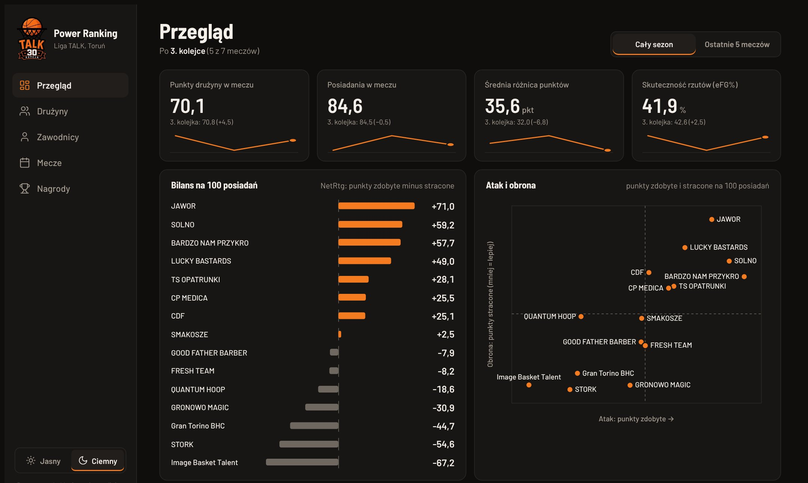
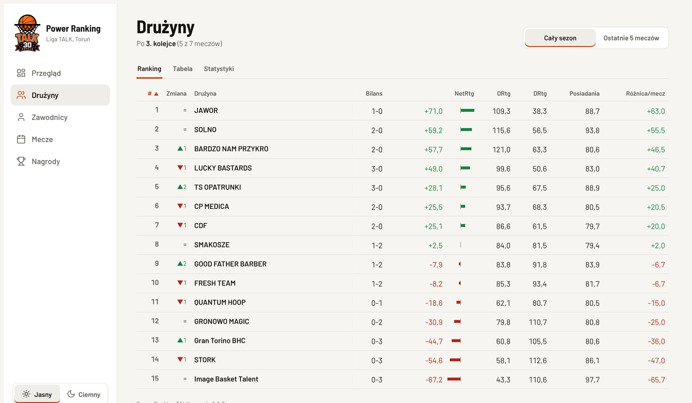
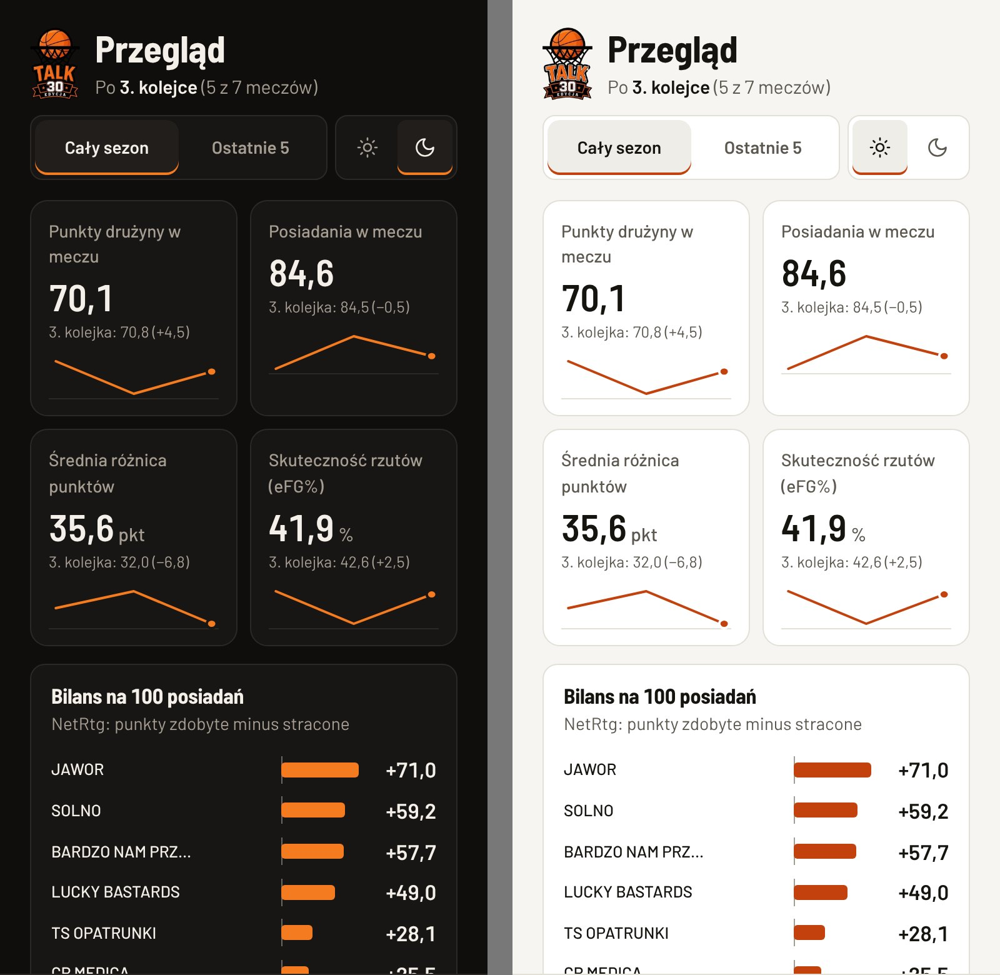
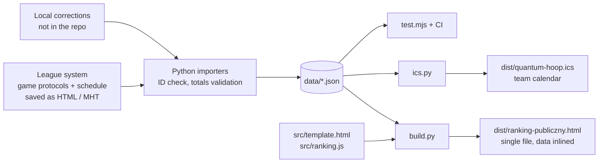

<p align="center">
  
</p>

<h1 align="center">TALK Power Ranking</h1>

<p align="center">
  Team and player ratings for an amateur basketball league in Toruń, rebuilt from the league's game protocols after every round.
</p>

<p align="center">
  
  
  
  <a href="https://github.com/tparzonka/talk-power-ranking/actions/workflows/ci.yml"></a>
</p>

<p align="center">
  <a href="https://claude.ai/artifact/XjkJB9hGr284QLAtPpMoKa"><b>Open the live page</b></a> (interface in Polish)
</p>



## At a glance

| | |
|---|---|
| **Role** | Author and product owner. Implementation built with Claude Code, see [Human vs. AI role](#human-vs-ai-role). |
| **Season** | 2026/27, live since 18 October 2026, updated after every round. |
| **Covers** | 15 teams: power ranking, league table, schedule with win probability, awards race, team calendar. |
| **Output** | One static HTML file with the data inlined. It opens without a server or a login. |
| **Stack** | Python importers, vanilla JavaScript, Node tests, GitHub Actions. |

## The problem

The league publishes box scores and a standings table. After a few rounds the table says little: a 40-point win and a 1-point escape both give two points, and a box score does not show which players help their team win. Finding out who is actually good meant reading protocols one by one.

This project turns the same protocols into ratings that account for pace, margin, opponent strength and on-court impact. A metric that needs more data than the season has produced stays hidden until it has enough.

## What it does

- **Overview.** KPI cards with a trend per round, NetRtg bars for every team, an attack and defense scatter, short insights taken from the data, top teams and players, latest results and upcoming games.
- **Teams.** Power ranking with rank movement, league table with play-off zones and form, team and opponent statistics, four factors, and a rank-by-round chart.
- **Players.** Ranking, per-40 statistics, a view per round and a player card with every game. The player data stays on the author's machine (see [Personal data](#6-personal-data)).
- **Games.** Results with links to protocols, the schedule, and win probability from round 4.
- **Awards.** MVP, best reserve, defender, scoring leader, U23 and 45+ categories, and All-NBA style first and second teams.
- **Calendar.** An iCalendar file with a team's upcoming games and stable UIDs, so a reschedule updates the existing event.
- **Interface.** Light and dark theme, a sidebar on desktop, a bottom tab bar on phones, and a switch between the whole season and the last 5 games.

| Teams, light theme | Phones, dark and light |
|---|---|
|  |  |

## How it works



| Layer | Component | Notes |
|---|---|---|
| Ingest | `scripts/import_html.py` | Parses saved protocol pages. The game ID from the URL makes imports idempotent: `BEZ ZMIAN` (no change) or `NADPISANY` (the league corrected the protocol). It checks player points against made shots and player totals against the team line. |
| Ingest | `scripts/terminarz.py` | Replaces the whole schedule on every import and prints what changed: new or removed games, reschedules, new results. |
| Ingest | `scripts/wiek.py` | Derives U23 and 45+ award categories from local rosters. Only the category is stored, never the birth date. |
| Model | `src/ranking.js` | Pure functions (`rankTeams`, `rankPlayers`, `leagueTable`, `winChance`). The same file runs in Node for tests and in the browser. |
| UI | `src/template.html` | Vanilla HTML, CSS and JavaScript. Sortable tables, player card, schedule, awards race, explanations. |
| Build | `scripts/build.py` | Inlines data, ranking code and version into one HTML file. |
| Calendar | `scripts/ics.py` | RFC 5545 calendar of upcoming games of one team. |
| Orchestration | `scripts/runda.sh` | One command per batch of files: import, build, calendar, test. |

### Ranking model

**Teams** are ordered by NetRtg: points scored minus allowed per 100 possessions, with margin per game as the tie-breaker. Possessions are FGA + 0.44 × FTA − ORB + TOV, averaged over both teams.

**Players** (at least 15 minutes per game) get a score of 50 + 10 × a weighted sum of z-scores against the league:

| Component | Weight | Window | What it measures |
|---|---|---|---|
| Impact on winning | 40% | last 5 games | on-court NetRtg, on/off difference, team record |
| Efficiency under load | 25% | last 5 games | (TS% − league TS%) × USG% / 20 |
| Versatility | 20% | season | PIE per game |
| Strength of schedule | 15% | season | average opponent NetRtg |

A toggle switches the whole page between the full season and the last 5 games. The full methodology (in Polish) is in [docs/PROJEKT.md](docs/PROJEKT.md).

## Engineering decisions

### 1. Plus/minus that does not add up
**Problem:** In the league's protocols the sum of player +/- is not 5 × the final margin, so on/off numbers built on raw +/- drift away from real results.
**Solution:** The gap is redistributed across players in proportion to minutes, and the "without player" baseline uses the real margin. On-court ratings are shrunk towards 0 with weight `possessions / (possessions + 60)` (`SHRINK` in `ranking.js`), so a hot 10-minute stint cannot top the ranking.

### 2. Re-importing without duplicates or silent errors
**Problem:** Protocols arrive in batches, get re-saved, and are sometimes corrected by the league days later.
**Solution:** Every game is keyed by its league ID. A re-import either changes nothing or overwrites the game with a clear message. The import stops when a player's points do not match his made shots or player totals do not match the team line. At the end the script prints which games of each round are still missing.

### 3. Errors at the source
**Problem:** The scorer's table makes mistakes: wrong jersey numbers, a phantom appearance of a few seconds for a player who was not dressed. Fixing the JSON by hand would be lost on the next re-import.
**Solution:** Corrections live in local files (numbers, protocol fixes, roster exceptions) and are applied on every import, so they survive league updates of the protocol.

### 4. Postponed games without a date
**Problem:** The league stores postponed games as 31 December with no time. Shown literally, that reads as a real New Year's Eve game.
**Solution:** The page shows "Termin do ustalenia" (date to be set). The calendar exports them as tentative all-day events. UIDs are derived from game IDs, so a reschedule updates the existing event.

### 5. Small samples early in the season
**Problem:** After 2 rounds most advanced metrics are noise.
**Solution:** Features switch on when the data can carry them: the rank-by-round chart and win probability from round 4, EWA from round 5. SRS is planned once teams share common opponents.

### 6. Personal data
**Problem:** Player box scores, rosters with birth dates and heights, jersey numbers and corrections are personal data of well over a hundred people. Age-based awards even need birth dates.
**Solution:** The public repository holds code and team-level data only. Everything that names a player stays on the local machine and is git-ignored, including the built page, because it inlines player data. Without those files the build still works and produces a teams-only page, so CI can test and build from the public data. A CI privacy guard fails if a player data file, a birth date or a raw league page is ever committed. All screenshots above come from the teams-only build.

## Interface and accessibility

Version 1.1.0 replaced a single long page with a dashboard: a sidebar with five views, an overview built from the data, and a theme switch. The redesign was followed by a measured review instead of a visual one:

- Text contrast was computed for every text element in both themes against WCAG AA. No failures remained.
- Tap targets were measured on a 390 px wide viewport. Links and player names got larger hit areas (44 px), and hover effects apply to mouse pointers only.
- A design linter ([impeccable](https://github.com/pbakaus/impeccable)) flagged 11 px chart labels and an overused typeface. The first finding led to a real bug: the attack and defense chart scaled down on phones until its labels were about 6 px tall. The chart is now drawn at the width of its container, and on narrow screens the dots carry the team's rank instead of its name. The typeface is now Barlow.
- Motion is limited to a 180 ms view fade and press feedback, with a `prefers-reduced-motion` fallback. Charts and numbers do not animate.

## Human vs. AI role

**Human (author):** the idea and product decisions; which metrics fit an amateur league and which do not (no clutch statistics or BPM without the data to support them); knowledge of the league, teams and players used to catch data errors; supplying protocols and schedules every round; design direction and review of every visual change.

**AI (Claude):** implementation of the importers, the rating model, the page and the calendar; data validation and cross-checks against protocols; tests and CI; design reviews on request.

## What I learned

- **Decide the privacy boundary first.** The rule "nothing that names a player is committed" shaped the repository, the build and the CI. Adding it later would have meant rewriting history.
- **Validate at the door.** Checks at import time caught scorer errors that would have skewed ratings without anyone noticing.
- **Show less when the data is thin.** Hiding a metric until the sample supports it is more honest than showing a noisy number with a decimal point.
- **Measure the interface.** A screenshot looked fine while the chart labels on phones were unreadable. Measuring found what looking did not.

## Running locally

Requirements: Python 3.9+ (with `beautifulsoup4` for importing protocols) and Node 18+.

```bash
python3 scripts/build.py              # build dist/ranking-publiczny.html
node scripts/test.mjs                 # check rankings and the league table
bash scripts/runda.sh saved-page.html # import protocols and/or schedule, then build and test
```

Local only (git-ignored): raw league pages in `input/`, player data in `data/` (box scores, rosters, age categories, numbers, corrections) and the built `dist/ranking-publiczny.html`. Without them the build produces a teams-only page.

## Project structure

```text
├── .github/workflows/ci.yml   # privacy guard, ranking tests, build
├── assets/                    # league logo (inlined into the page), favicon
├── data/
│   ├── mecze_druzyn.json      # team box scores, one row per team per game
│   ├── druzyny.json           # teams
│   └── terminarz.json         # schedule and results from the league system
├── dist/quantum-hoop.ics      # team calendar
├── docs/                      # PROJEKT.md (documentation and roadmap, Polish), screenshots
├── scripts/                   # importers, build, calendar, tests
├── src/
│   ├── ranking.js             # rating model (pure functions)
│   └── template.html          # page layout, styles and UI logic
└── VERSION
```

## Technology

- **Front end:** HTML, CSS and vanilla JavaScript; Barlow and Barlow Semi Condensed from Google Fonts. The page makes no other network calls.
- **Data pipeline:** Python 3, BeautifulSoup.
- **Testing:** Node.js ranking tests and GitHub Actions. Playwright was used for visual checks during development and is not part of the repository.
- **Output:** a single static HTML file and an iCalendar file (RFC 5545).

## Notes

- No secrets, tokens or API keys are used or stored.
- Team statistics and the schedule come from the league's public game protocols. The TALK logo, protocols and schedule belong to the league. This is an independent fan project, not affiliated with the league organisers.
- Favicon: basketball by Keistutis, public domain ([openclipart.org](http://openclipart.org/detail/181007/basketball-krepsinio-kamuolys-ball-by-keistutis-181007)).
- No license: all rights reserved. The code is public for reading and reference.
