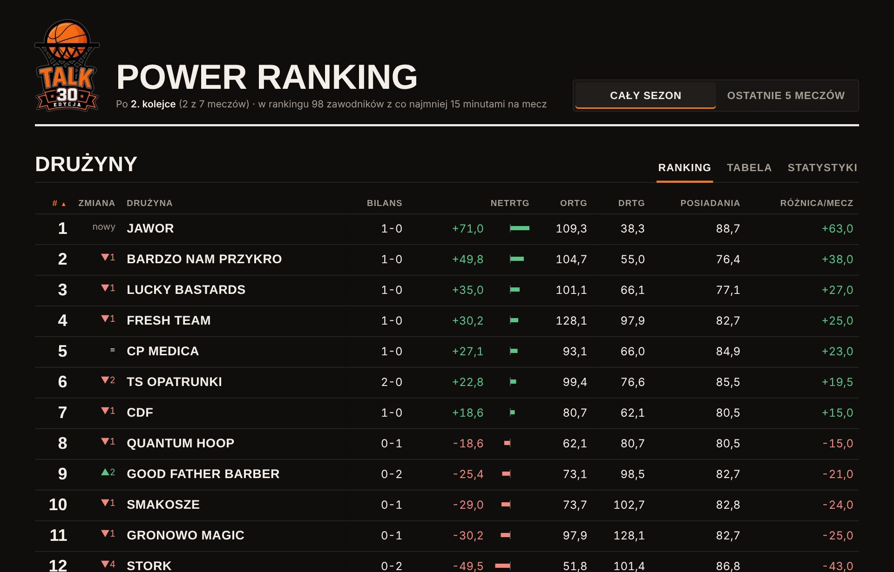
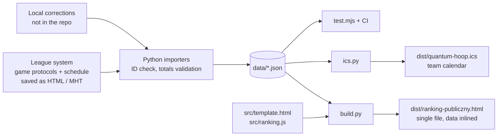

# TALK Power Ranking

> A neutral, stats-driven power ranking for the TALK amateur basketball league in Toruń (season 2026/27). It is built from the league's game protocols and updated after every round. The output is a single HTML page that opens without a server.


[](https://github.com/tparzonka/talk-power-ranking/actions/workflows/ci.yml)

**Live page:** [claude.ai/artifact/XjkJB9hGr284QLAtPpMoKa](https://claude.ai/artifact/XjkJB9hGr284QLAtPpMoKa) (UI in Polish)



## Why

The league publishes box scores and a standings table. After a few rounds the table says little: a 40-point blowout and a 1-point escape both give 2 points, and box scores alone don't show which players help their team win. This project turns the same protocols into team and player ratings that account for pace, margin, opponent strength and on-court impact. Metrics that need more data stay hidden until the season provides it.

## Architecture Overview



| Layer | Component | Notes |
|---|---|---|
| Ingest | `scripts/import_html.py` | Parses saved protocol pages. The game ID from the URL makes imports idempotent: `BEZ ZMIAN` (no change) or `NADPISANY` (league corrected the protocol). Validates player points against made shots and player totals against the team line. |
| Ingest | `scripts/terminarz.py` | Replaces the whole schedule on every import and prints what changed: new or removed games, reschedules, new results. |
| Ingest | `scripts/wiek.py` | Derives U23 / 45+ award categories from local rosters. Only the category is stored, never the birth date. |
| Model | `src/ranking.js` | Pure functions (`rankTeams`, `rankPlayers`, `leagueTable`, `winChance`). Same file runs in Node for tests and in the browser. |
| UI | `src/template.html` | Vanilla HTML/CSS/JS, no framework, no runtime dependencies. Sortable tables, player card, schedule, awards race, explanations. |
| Build | `scripts/build.py` | Inlines data, ranking code and version into one HTML file that opens without a server or login. |
| Calendar | `scripts/ics.py` | RFC 5545 calendar of upcoming QUANTUM HOOP games with stable UIDs. |
| Orchestration | `scripts/runda.sh` | One command per batch of files: import → build → calendar → test. |

## Ranking Model

**Teams** are ordered by NetRtg (points scored minus allowed per 100 possessions), with margin per game as the tie-breaker. Possessions = FGA + 0.44 × FTA − ORB + TOV, averaged over both teams.

**Players** (min. 15 minutes per game) get a score of 50 + 10 × a weighted sum of z-scores against the league:

| Component | Weight | Window | What it measures |
|---|---|---|---|
| Impact on winning | 40% | last 5 games | on-court NetRtg, on/off difference, team record |
| Efficiency under load | 25% | last 5 games | (TS% − league TS%) × USG% / 20 |
| Versatility | 20% | season | PIE per game |
| Strength of schedule | 15% | season | average opponent NetRtg |

A toggle switches the whole page between the full season and the last 5 games of each team and player. The full methodology (in Polish) is in [docs/PROJEKT.md](docs/PROJEKT.md).

## Engineering Challenges & Solutions

### 1. Plus/minus that doesn't add up
**Problem:** In the league's protocols the sum of player +/- is not 5 × the final margin, so on/off numbers built on raw +/- drift away from real results.
**Solution:** The gap is redistributed across players in proportion to minutes, and the "without player" baseline uses the real margin. On-court ratings are shrunk towards 0 with weight `possessions / (possessions + 60)` (`SHRINK` in `ranking.js`), so a hot 10-minute stint can't top the ranking.

### 2. Re-importing without duplicates or silent errors
**Problem:** Protocols arrive in batches, get re-saved, and are sometimes corrected by the league days later.
**Solution:** Every game is keyed by its league ID. A re-import either changes nothing or overwrites the game with a clear message. The import stops when a player's points don't match his made shots or player totals don't match the team line. At the end the script prints which games of each round are still missing.

### 3. Errors at the source
**Problem:** The scorer's table makes mistakes: wrong jersey numbers, a phantom appearance of a few seconds for a player who wasn't dressed. Fixing the JSON by hand would be lost on the next re-import.
**Solution:** Corrections live in local correction files (numbers, protocol fixes, roster exceptions) and are applied on every import, so they survive league updates of the protocol. They name individual players, so they are kept out of the repository.

### 4. Postponed games without a date
**Problem:** The league stores postponed games as 31 December with no time. Shown literally, that reads as a real New Year's Eve game.
**Solution:** The page shows "Termin do ustalenia" (date TBD). The calendar exports them as tentative all-day events titled `TBD TALK: vs …`. UIDs are derived from game IDs, so a reschedule updates the existing event instead of creating a second one.

### 5. Small samples early in the season
**Problem:** After 2 rounds most advanced metrics are noise.
**Solution:** Features switch on when the data can carry them: the rank-by-round chart and win probability from round 4, EWA from round 5. SRS is planned once teams share common opponents.

### 6. Personal data
**Problem:** Player box scores, rosters with birth dates and heights, jersey numbers and corrections are personal data of about 100 people. Age-based awards (U23, 45+) even need birth dates.
**Solution:** The public repository contains code and team-level data only. Everything that names a player stays on the local machine and is git-ignored. That includes the built page, because it inlines player data. Without those files the build still works and produces a teams-only page, so CI can test and build from the public data. A CI privacy guard fails if a player data file, a birth date or a raw league page is ever committed.

## Project Structure

```text
├── .github/workflows/ci.yml   # privacy guard, ranking tests, build
├── assets/logo.webp           # league logo (inlined into the page)
├── data/
│   ├── mecze_druzyn.json      # team box scores, one row per team per game
│   ├── druzyny.json           # teams
│   └── terminarz.json         # schedule and results from the league system
├── dist/quantum-hoop.ics      # team calendar
├── docs/PROJEKT.md            # full documentation, changelog and roadmap (Polish)
├── scripts/                   # importers, build, calendar, tests
├── src/
│   ├── ranking.js             # rating model (pure functions)
│   └── template.html          # page layout, styles and UI logic
└── VERSION
```

## Running Locally

Requirements: Python 3.9+ (with `beautifulsoup4` for importing protocols) and Node 18+.

```bash
python3 scripts/build.py              # build dist/ranking-publiczny.html
node scripts/test.mjs                 # check rankings and the league table
bash scripts/runda.sh saved-page.html # import protocols and/or schedule, then build and test
```

Local only (git-ignored): raw league pages in `input/`, player data in `data/` (box scores, rosters, age categories, numbers, corrections) and the built `dist/ranking-publiczny.html`. Without them the build produces a teams-only page.

## History

- **1.0 (18.10.2026):** team and player rankings, league table with form, team/opponent stats, four factors, per-40 stats, player card, schedule and awards race, ID-checked imports.
- **1.0.2 (21.10.2026):** position of players without one in the league system is taken from the nearest average height per position in the league.
- **1.0.1 (19.10.2026):** jersey numbers, league table zones (play-off 1-8, 9-12, 13-15), team calendar, visual polish.

## Human vs. AI Role

**Human (author):** the idea and product decisions; which metrics fit an amateur league and which don't (no clutch stats or BPM without the data to support them); knowledge of the league, teams and players used to catch data errors; supplying protocols and schedules every round; design direction and review of every visual change.

**AI (Claude):** implementation of the importers, the rating model, the page and the calendar; data validation and cross-checks against protocols; tests and CI; design reviews on request.

## Technology Stack

- **Front end:** HTML, CSS, vanilla JavaScript; Saira Condensed and Source Sans 3
- **Data pipeline:** Python 3, BeautifulSoup
- **Testing:** Node.js (ranking tests), GitHub Actions; Playwright for visual checks during development (not part of the repo)
- **Output:** single static HTML file, iCalendar (RFC 5545)

## Security & Privacy Note

- No secrets, tokens or API keys are used or stored. The page makes no network calls apart from loading fonts from Google Fonts.
- The repository holds no personal data: no player names, numbers, heights, birth dates or individual statistics. Those files and the built page stay on the local machine; the CI privacy guard enforces it.
- Team statistics and the schedule come from the league's public game protocols.
- The TALK logo, game protocols and schedule belong to the league. This is an independent fan project, not affiliated with the league organisers.

## License

No license: all rights reserved. The code is public for reading and reference.
